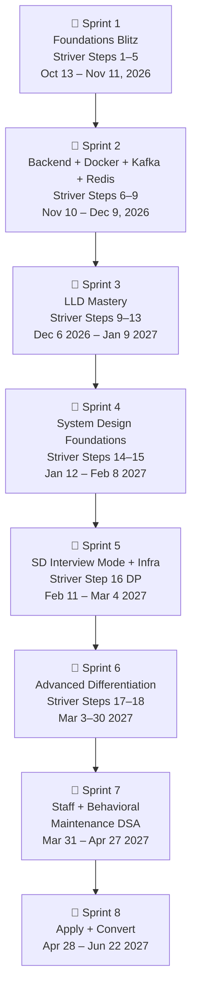

# 🗺️ MAANG / Senior / Staff — Master Roadmap
**Profile:** 6 YOE · SDE-2 → Staff target · MAANG + Top Startups  
**Weekday Hours:** 6:00–10:00 AM (4h) + 7:00–10:00 PM (3h) = **7 hrs/day**  
**Weekend Hours:** 6:00 AM–4:00 PM + 7:00–10:00 PM = **~10 hrs/day**  
**DSA:** [Striver A2Z Sheet](https://takeuforward.org/strivers-a2z-dsa-course/strivers-a2z-dsa-course-sheet-2/) — 455+ problems, 18 Steps  
**SD Supplement:** [systemoverflow.com](https://systemoverflow.com) — 33 Topics, 200+ Concepts, 3000+ Cards  
**Start:** October 13, 2026 · **Target:** May 2027

---

## ⏰ Daily Schedule

### Weekdays (Mon–Fri) — 7 hours

| Time | Block | Activity |
|---|---|---|
| 6:00–7:30 AM | 🔴 DSA | Striver A2Z — 2 problems from current step. Always read editorial after solving. |
| 7:30–7:45 AM | Break | Walk / water / stretch |
| 7:45–10:00 AM | 🔵 Domain A | Current repo phases — deep reading + hands-on |
| 7:00–8:30 PM | 🔵 Domain B | Continue current repo OR adjacent repo |
| 8:30–8:45 PM | Break | |
| 8:45–10:00 PM | 🟢 Practice | Coding drill / Design drill / Mock / Review notes |

### Weekends (Sat–Sun) — ~10 hours

| Time | Block | Activity |
|---|---|---|
| 6:00–7:30 AM | 🔴 DSA | 1 medium + 1 hard from current Striver step (timed, no hints) |
| 7:30–7:45 AM | Break | |
| 7:45–10:00 AM | 🟡 Revision A | Revisit weakest phases from the week — re-read, re-summarize |
| 10:00–11:30 AM | 🟡 Revision B | Redo the LLD/SD problem from the week you struggled most |
| 11:30 AM–1:00 PM | 🟠 Mock | Full timed mock — LLD (45 min) OR SD (60 min) |
| 1:00–2:00 PM | Lunch break | |
| 2:00–4:00 PM | 🟡 Revision C | systemoverflow.com — study 1–2 topic cards relevant to the week's SD content |
| 7:00–8:00 PM | 🟡 Revision D | Write your own 1-page summary of the week's key learnings (in your own words) |
| 8:00–9:00 PM | 🟢 Behavioral | STAR story practice — rehearse 1 story aloud, time it, refine it |
| 9:00–10:00 PM | 🔴 DSA Revision | Re-solve 2–3 problems from earlier in the week that you struggled with |

> [!IMPORTANT]
> The weekend revision blocks are non-negotiable. **Re-doing problems you struggled with** is where 80% of learning happens. Reading without revision has a 90% forgetting rate in 48 hours.

---

## 🔍 Repo-by-Repo Gap Analysis

> Each repo reviewed thoroughly. Missing topics flagged and assigned to revision slots or supplementary resources.

---

### 1. `operating-systems-from-scratch` (132 phases) ✅ Comprehensive

**What's covered:** Process/thread lifecycle, scheduling, memory management (paging, TLB, CoW, mmap), filesystem (inodes, journaling, fsync), I/O (epoll, event loop, sockets), IPC, signals, namespaces, cgroups, containers from OS primitives, perf profiling, capstones.

**Excellent phases for Senior/Staff:**
- `44-mmap-deep-dive`, `45-copy-on-write` → frequently probed in system design (memory-mapped files)
- `70-epoll-deep-dive`, `71-the-event-loop` → critical for backend/Redis/Kafka understanding
- `95–99` (namespaces + cgroups) → directly ties into Docker/K8s interviews
- `114–116` (cache hierarchy, locality, false sharing) → performance engineering questions

**Missing topics to cover supplementarily:**
- `io_uring` (modern Linux async I/O) — read [this article](https://developers.redhat.com/articles/2023/04/12/why-you-should-use-iouring-async-io) during weekend revision
- NUMA architecture — 5-minute read, useful for senior infra interviews

---

### 2. `computer-networking-from-scratch` (139 phases) ✅ Extremely Comprehensive

**What's covered:** Full OSI stack, ARP, routing, TCP/UDP from scratch, DNS, HTTP/1.1/2/3/QUIC, TLS 1.3, NAT, firewalls, load balancers (L4/L7), CDN, proxies, network namespaces, packet debugging, all major failure labs.

**Excellent phases for Senior/Staff:**
- `44-tcp-congestion-control`, `45-bandwidth-delay-product` → asked in performance interviews
- `66-http-2-concepts`, `67-http-3-quic-concepts` → system design for modern APIs
- `107-bufferbloat-concept`, `111-partial-failure`, `112-split-brain-concept` → distributed systems gold

**Missing topics to cover supplementarily:**
- **gRPC** deep-dive (covered in `backend` repo at phases 194–197, link it)
- **WebRTC** basics — 1 weekend read, relevant for video/audio SD questions
- **BGP** internals — superficial coverage here, not critical for SWE interviews (skip)

---

### 3. `database-and-sql-from-scratch` (102 phases) ✅ Extremely Comprehensive

**What's covered:** Full SQL (SELECT → Window Functions → CTEs → Recursive CTEs), indexes (B-tree, composite, partial, EXPLAIN), transactions (ACID, isolation levels, MVCC, deadlocks), schema design, normalization, partitioning, replication, N+1, ORM, migrations, full project set.

**Excellent phases for Senior/Staff:**
- `34–40` (window functions) → asked in data-heavy SQL rounds at Amazon/Meta
- `52–63` (indexes + query planner) → deep performance questions
- `65–72` (transactions, MVCC, isolation levels) → distributed DB questions
- `43`, `45–47` (gaps-and-islands, funnel queries, cohort/retention) → analytical SQL mastery

**Missing topics to cover supplementarily:**
- **Bloom filters** in DB context — covered in `nosql` repo, cross-reference
- **LSM trees vs B-trees** as storage engines — covered in `backend` phases 198–201, link
- **Connection pool sizing math** — Little's Law (covered in `backend` phase 157)

---

### 4. `java-from-scratch` (204 phases) ✅ Very Comprehensive

**What's covered:** JVM internals (bytecode, GC, class loading, JIT), OOP, generics, collections, concurrency (threads, locks, volatile, atomic, ExecutorService, CompletableFuture, Fork/Join), reactive, testing, Spring motivation, broken labs (NPE, deadlock, memleak, GC thrash, pool exhaust).

**Excellent phases for Senior/Staff:**
- `phase-190-broken-lab-deadlock` → live debugging question at Google
- `phase-191-broken-lab-memleak`, `phase-192-broken-lab-gc-thrash` → SRE-style debugging
- `phase-161–165` (JVM flags, startup vs throughput, defensive security, resource lifecycle)
- `phase-194–204` (protobuf/gRPC, TLS/mTLS, LSM trees, B-tree storage engine) — this is deep backend engineering usually missing from Java courses

**Missing topics:**
- **Java 21 Virtual Threads (Project Loom)** — significant for modern backend. Add to Week 5 revision: read [JEP 444](https://openjdk.org/jeps/444)
- **Structured concurrency** (Java 21) — skim during Week 5 weekend
- **GraalVM native image** — weekend read, relevant for startup interview discussions

---

### 5. `backend-engineering-from-scratch` (206 phases) ✅ Outstanding — Most Interview-Dense Repo

**What's covered:** Full backend stack (TCP server, HTTP, REST, auth, DB, caching, queuing, event-driven, resilience, observability, security, performance, debugging labs, microservices intro, projects). Plus deep sections on Raft, gRPC, LSM trees, B-trees, TLS/mTLS (phases 190–205).

**Exceptional phases for Senior/Staff:**
- `190–192` (Raft leader election, log replication, 2PC+Saga) — system design goldmine
- `193` (Protobuf wire format) — asked at Google
- `194–197` (HTTP/2 framing, gRPC client/stub, interceptors) — asked at Meta/Stripe
- `198–201` (WAL, LSM + SSTables, leveled compaction, B-tree + buffer pool) — storage engine depth
- `202–205` (HMAC, AES-GCM, TLS handshake, mTLS, zero-trust PASETO) — security depth rarely covered
- `160–169` (debugging labs: slow API, 500 errors, connection pool exhaustion, Redis down, etc.) — directly mirrors real senior-round debugging questions

**Missing topics:** None significant — this repo is exceptionally complete.

---

### 6. `low-level-design-from-scratch` (147 phases) ✅ Very Comprehensive

**What's covered:** Full OOP, SOLID, all 23 GoF design patterns, API design, UML, LLD framework + 30 classic problems (Parking Lot through TaskScheduler), refactoring challenges, concurrency challenges, LLD ↔ DB/HTTP/Events/SD integration phases, 3 interview simulations, capstones.

**Excellent phases for Senior/Staff:**
- `125-concurrency-challenge` — concurrent booking, thread-safety in OOP (rarely covered)
- `128-design-review-skill`, `129-tradeoff-thinking`, `130-pattern-selection` — meta-skills for staff interviews
- `131-anti-patterns-catalog`, `132-when-not-to-abstract` — critical senior judgment
- `133–136` (LLD ↔ DB/HTTP/Events/SD integration) — bridges LLD to system design

**Missing topics to cover supplementarily:**
- **Domain-Driven Design (DDD)** concepts — Aggregates, Bounded Contexts, Value Objects. Key for staff-level design discussions. Add to Weekend Revision in Sprint 3.
- **CQRS at LLD level** — partially in backend, add a dedicated 30-min session in Week 13

---

### 7. `system-design-from-scratch` (201 phases) ✅ Outstanding

**What's covered:** Full scaling path, CAP/PACELC, all distributed systems primitives, 40+ real system designs (URL shortener to stock exchange), 5 interview simulations, 7 capstones, failure/architecture review days.

**Exceptional phases for Senior/Staff:**
- `59–61` (time in distributed systems, logical clocks, vector clocks) — asked at Google
- `64–66` (consensus, Raft mental model) — asked at Confluent, CockroachDB
- `73` (transactional outbox) + `74` (CDC) — critical for event-driven SD interviews
- `172` (stock exchange CLOB) — hardest SD question, shows depth

**Gap: systemoverflow.com integration** → See dedicated section below.

---

### 8. `kafka-from-scratch` (68 phases) ✅ Comprehensive

**What's covered:** Append-only log, offsets, partitions, consumer groups, producers, exactly-once semantics, Kafka Streams, compaction, retention, anti-patterns, final mental model.

**Missing topics to cover supplementarily:**
- **Kafka Connect** — source/sink connectors for CDC. Add a 30-min session in Sprint 4.
- **Schema Registry + Avro** — important for data engineering interviews. Covered lightly in `data-eng` repo.
- **Kafka vs Pulsar vs Kinesis** trade-off verbal — add to Sprint 4 revision weekend.

---

### 9. `redis-from-scratch` (51 phases) ✅ Comprehensive

**What's covered:** KV store from scratch, RESP protocol, all data types, expiry, persistence (RDB/AOF), pub/sub, pipelining, Lua scripts, Redis Cluster, Sentinel, anti-patterns.

**Missing topics:**
- **Redis Streams** (XADD/XREAD) — emerging pattern for event sourcing. Add 1 evening in Sprint 4.
- **Redis Stack** (JSON, Search, TimeSeries modules) — used at startups. Quick weekend read.
- **Redis vs Memcached** trade-off articulation — add to Sprint 4 verbal drills.

---

### 10. `kubernetes-from-scratch` (121 phases) ✅ Very Comprehensive

**What's covered:** Full K8s (Pods → Deployments → Services → Ingress → RBAC → autoscaling → StatefulSets → security → operators → GitOps → observability → failure labs → projects).

**Exceptional phases for Senior/Staff:**
- `83-custom-resources`, `84-build-a-tiny-controller`, `85-operators` — Kubernetes operator pattern (asked at platform engineering interviews)
- `88-gitops-concept` — ArgoCD/Flux pattern, critical for DevOps/Platform roles
- `117-build-mini-kubernetes` — extraordinary depth for architecture discussions
- `119-kubernetes-in-system-design` — bridges K8s to SD interviews

**Missing topics:**
- **Service Mesh** (Istio/Linkerd basics) — mTLS between services, traffic management. Add a 1-hr weekend session in Sprint 5.
- **OPA / Gatekeeper** — policy enforcement. Quick read in Sprint 6 revision.

---

### 11. `elasticsearch-from-scratch` (88 phases) ✅ Comprehensive

**What's covered:** Inverted index, tokenization, BM25, ES architecture (sharding/replication), query DSL, aggregations, mappings, analyzers, relevance tuning, vector search, anti-patterns.

**Missing topics:**
- **Elasticsearch vs OpenSearch** fork differences — 5-min read
- **Hybrid search** (keyword + vector) — used at most AI startups. Add to Sprint 6 weekend.
- **Index lifecycle management (ILM)** — for time-series data in ES. Add 30 min in Sprint 6.

---

### 12. `nosql-databases-and-query-languages-from-scratch` (264 phases)

**Based on phase naming (phases 01–99 visible):** Covers MongoDB, Cassandra, DynamoDB, graph DBs, time series, vector DBs, tombstones, compaction strategies, token ring.

**What's excellent:** Covers Cassandra internals very deeply (compaction, tombstones, token ring — phases 95–99).

**Missing topics (check if covered in remaining phases 100–264):**
- **HBase** — used at Uber/LinkedIn. If not covered, add to Sprint 6 weekend revision.
- **FoundationDB** — used at Apple. Quick read.
- **Cosmos DB** — Microsoft's multi-model DB. Add if targeting Microsoft.
- **Redis as NoSQL** — cross-reference with `redis` repo.

---

### 13. `linux-from-scratch` (136 phases) ✅ Comprehensive

**What's covered:** Terminal, shell, filesystem, processes, signals, permissions, networking commands, text processing (grep/awk/sed), bash scripting, cron, services, performance tools (top/htop/strace), security (SSH hardening, file permissions).

**Missing topics:**
- **`perf` tool deep usage** — covered in OS repo at phases 92–94, cross-reference
- **`systemtap` / `bpftrace`** — eBPF-based tracing. Used at Netflix/Meta for performance. Add a 1-hr weekend read in Sprint 1.
- **Linux kernel networking stack** (tc, iptables, nftables) — partially in networking repo. Cross-reference.

---

### 14. `docker-from-scratch` (31 phases) ✅ Sufficient

**What's covered:** Containers from first principles, images, layers, Dockerfile, docker-compose, networking, volumes, multi-stage builds, debugging.

**Missing topics:**
- **BuildKit** — modern Docker build engine. Quick read.
- **Docker security** (rootless containers, seccomp, AppArmor) — add 30 min in Sprint 2 revision.
- **Container image scanning** (Trivy, Snyk) — add to Sprint 2 revision.

---

### 15. `staff-engineering-and-product-mindset-from-scratch` (201 phases) ✅ Outstanding

**What's covered:** Full staff+ mental model — impact, vision, architecture leadership, tech debt, roadmaps, stakeholder management, mentoring, incident leadership, product thinking, case studies, simulations (200 phases).

**Exceptional phases:**
- `phase-18-decision-journals` — powerful tool for behavioral interview answers
- `phase-00` to `phase-10` — the mindset shift from senior to staff (read this FIRST, even before Sprint 1, as a primer)
- All case studies (phases 95–99) — actual staff-level interview scenarios

**Missing:** Nothing significant. This is a complete staff prep resource.

---

## 🌐 System Overflow Integration Plan

**What it is:** [systemoverflow.com](https://systemoverflow.com) — 33 topics, 200+ concepts, 3000+ flashcards. Focuses on **"why behind architectural decisions"** — trade-offs, failure modes, production insights. Spaced repetition for long-term retention.

**How to use it alongside your repos:**

| When | How |
|---|---|
| **Sprint 4–5 weekends** | Use System Overflow's flashcard topics to reinforce concepts learned in `sd` repo that week. Do 1 topic card set per weekend (e.g., "Replication & Consistency" cards after studying SD phases 127–136) |
| **Sprint 6–7 weekends** | Use System Overflow's ML System Design and advanced topics (Geospatial, Search & Ranking) as supplementary depth for differentiation |
| **Sprint 8 (active interviews)** | Daily 20-min System Overflow review session to keep concepts fresh using spaced repetition |

**System Overflow's 33 topics mapped to your sprints:**

| System Overflow Topic | Use In | Your Repo Supplement |
|---|---|---|
| Networking & Protocols | Sprint 1 weekend revision | `networking` repo |
| OS & Systems Fundamentals | Sprint 1 weekend revision | `os` repo |
| Database Design | Sprint 1 weekend + Sprint 4 | `sql` + `nosql` repos |
| Replication & Consistency | Sprint 4 Week 15 | `sd` phases 127–136 |
| Partitioning & Sharding | Sprint 4 Week 14 | `sd` phases 109–117 |
| Load Balancing | Sprint 4 Week 14 | `sd` phases 21–30 |
| Caching Patterns | Sprint 4 Week 14 | `sd` phases 66–73 |
| Message Queues & Streaming | Sprint 4 Week 16 | `kafka` repo |
| Rate Limiting | Sprint 5 | `sd` + `backend` |
| Object Storage & Blob Storage | Sprint 5 | `sd` phase 77–78 |
| Data Processing Patterns | Sprint 6 | `data-eng` repo |
| Big Data Systems | Sprint 6 | `olap` repo |
| Search & Ranking Systems | Sprint 6 | `elasticsearch` repo |
| Geospatial & Location Services | Sprint 5 | `sd` phase 137 |
| ML System Design | Sprint 6 | `ai-eng` + `ai-sys` repos |
| Resilience & Service Patterns | Sprint 5 | `sd` phases 182–188 |

> [!TIP]
> System Overflow's **spaced repetition cards** are best used during commute or low-energy moments. Don't schedule them as primary deep-work sessions — use them as top-up review on top of your repo study.

---

## 🗓️ Sprint-by-Sprint Schedule

---

## 🔶 Sprint 1 — Foundations Blitz
**Weeks 1–4 | Oct 13 – Nov 11, 2026**  
**Repos:** `os` (132) + `linux` (136) + `networking` (139) + `sql` (102) + `java` start  
**Striver:** Steps 1–5 (Basics, Sorting, Arrays, Binary Search, Strings)

---

### Week 1 — Oct 13–19 | OS + Linux + Striver Steps 1–2

| Day | 7:45–10:00 AM (Domain A) | 7:00–8:30 PM (Domain B) | 8:45–10:00 PM (Practice) |
|---|---|---|---|
| **Mon** | `os` 01–10 (what is OS, kernel space, process lifecycle, fork, exec) | `linux` 01–10 (terminal, shell, filesystem, navigation) | Striver Step 1: TC, basic maths (GCD, prime sieve, power) |
| **Tue** | `os` 11–20 (shell redirection, pipes, FDs, syscalls, strace lab) | `linux` 11–20 (file ops, redirection, pipes, grep) | Striver Step 1: Basic recursion (factorial, fibonacci, all subsets) |
| **Wed** | `os` 21–30 (threads, scheduling, context switch, mutex, semaphore) | `linux` 21–30 (processes/signals/jobs, permissions, users) | Striver Step 2: Bubble, Selection, Insertion sort implementations |
| **Thu** | `os` 31–40 (deadlock, memory layout, paging, TLB, page faults) | `linux` 31–40 (networking: curl, netstat, ss, ping, dig) | Striver Step 2: Merge Sort + Quick Sort recursive |
| **Fri** | `os` 41–50 (demand paging, page replacement, thrashing, mmap, CoW, malloc) | `linux` 41–50 (disk: df, du, lsof, iostat, text processing: awk, sed, cut) | Striver Step 3 Easy: Two Sum, Contains Duplicate, Missing Number |
| **Sat** | **REVISION A:** Re-read weakest `os` phases from the week | **REVISION B:** System Overflow — "OS & Systems Fundamentals" cards | **MOCK:** Verbal — "Explain process vs thread to an interviewer" |
| **Sun** | **REVISION C:** Redo `linux` phases you skimmed | **REVISION D:** Write 1-page summary: OS concepts you'd explain in an interview | Striver Step 3 Easy: Max Consecutive Ones, Largest Element, Second Largest |

---

### Week 2 — Oct 20–26 | OS Finish + Networking Start

| Day | 7:45–10:00 AM | 7:00–8:30 PM | 8:45–10:00 PM |
|---|---|---|---|
| **Mon** | `os` 51–62 (files, inodes, fsync, crash consistency, journaling, I/O stack) | `linux` 51–62 (bash scripting: variables, loops, conditionals, functions) | Striver Step 3 Medium: Sort Colors, Best Time Buy/Sell Stock I |
| **Tue** | `os` 63–74 (blocking/non-blocking I/O, select, poll, epoll, event loop) | `linux` 63–73 (cron, systemd, journalctl, service mgmt) | Striver Step 3 Medium: Rearrange +ve/-ve, Next Permutation |
| **Wed** | `os` 75–86 (TCP server, sockets, signals, graceful shutdown, timers, interrupts) | `linux` 74–84 (perf tools: top, htop, vmstat, strace, perf intro) | Striver Step 3 Medium: Set Matrix Zeroes, Rotate Matrix, Spiral Matrix |
| **Thu** | `os` 87–99 (procfs, sysfs, resource limits, perf profiling, namespaces, cgroups) | `linux` 85–96 (package mgmt, SSH hardening, file permission security, `bpftrace` read) | Striver Step 3 Hard: Pascal's Triangle, Majority Element I & II |
| **Fri** | `os` 100–116 (containers from OS, capabilities, VMs vs containers, boot, systemd, cache hierarchy, false sharing) | `networking` 01–15 (why networks, bits on wire, latency, layers, encapsulation, Ethernet, MAC) | Striver Step 3 Hard: 3Sum, 4Sum |
| **Sat** | **REVISION A:** `os` 117–132 (finish — broken labs, all capstones, OS in system design) | **REVISION B:** System Overflow — "Networking & Protocols" cards | **MOCK:** Verbal — "What happens when you type google.com in a browser?" |
| **Sun** | **REVISION C:** Redo 3 `os` phases you found hardest | **REVISION D:** 1-page summary: OS primitives that matter in distributed systems | Striver Step 3 Hard: Trapping Rainwater, Product Array Except Self |

---

### Week 3 — Oct 29 – Nov 4 | Networking + Striver Step 3 Hard Finish + Step 4 Binary Search

| Day | 7:45–10:00 AM | 7:00–8:30 PM | 8:45–10:00 PM |
|---|---|---|---|
| **Mon** | `networking` 16–30 (ARP, IPv4, subnets, CIDR, routing tables, longest-prefix match) | `networking` 31–45 (TCP from scratch: 3-way handshake, seq/ack, flow control, congestion) | Striver Step 3 Hard: Merge Overlapping Intervals, Merge Two Sorted Arrays without extra space |
| **Tue** | `networking` 46–60 (TCP teardown, TIME_WAIT, UDP, DNS hierarchy, recursive resolver) | `networking` 61–75 (HTTP/1.1→2→3/QUIC, TLS 1.3, certificates, mTLS concept) | Striver Step 3 Hard: Count Inversions, Reverse Pairs |
| **Wed** | `networking` 76–90 (NAT, firewalls, proxies, load balancing L4/L7, health checks, connection pooling) | `networking` 91–99 (network namespaces, veth pairs, linux bridge, build tiny internet, tcpdump) | Striver Step 4: Binary Search on 1D — floor/ceil, first/last occurrence, count in sorted |
| **Thu** | `networking` 100–115 (performance: latency, throughput, loss, jitter; failure labs: DNS, routing, firewall) | `networking` 116–129 (broken network labs, projects: raw TCP chat, HTTP server, DNS resolver, reverse proxy, load balancer) | Striver Step 4: Search in Rotated Sorted, Min in Rotated, Find K-th element of two sorted arrays |
| **Fri** | `networking` 130–139 (finish: networking + Docker/K8s/AWS/SD final mental model) | `java` 01–20 (JVM, bytecode, types, primitives vs references, OOP, classes, interfaces) | Striver Step 4: Koko Eating Bananas, Aggressive Cows, Book Allocation |
| **Sat** | **REVISION A:** Redraw OSI model from memory with real examples at each layer | **REVISION B:** System Overflow — "Networking & Protocols" (finish remaining cards) | **MOCK:** Verbal — "Explain how TLS handshake works end-to-end" (timed, 5 mins) |
| **Sun** | **REVISION C:** Re-do hardest networking failure lab | **REVISION D:** 1-page: "Networking concepts that show up in system design interviews" | Striver Step 4: Median of Two Sorted Arrays, Find Peak Element, Matrix Median |

---

### Week 4 — Nov 3–9 | SQL + Java + Striver Step 4 Finish + Step 5 Strings

| Day | 7:45–10:00 AM | 7:00–8:30 PM | 8:45–10:00 PM |
|---|---|---|---|
| **Mon** | `sql` 01–20 (relational model, SELECT, WHERE, NULL logic, JOINs — inner/left/right/full) | `java` 21–40 (generics, collections internals: HashMap, LinkedHashMap, TreeMap, PriorityQueue) | Striver Step 4: Search in 2D Matrix I & II, Find Peak in 2D, Row with Max 1s |
| **Tue** | `sql` 21–47 (aggregates, GROUP BY, HAVING, window functions — ROW_NUMBER, RANK, LAG/LEAD, running totals, frames) | `java` 41–60 (threads, synchronized, ReentrantLock, volatile, atomic CAS) | Striver Step 5 Strings: Reverse Words, Largest Odd Number, Longest Common Prefix |
| **Wed** | `sql` 48–72 (indexes B-tree/composite/partial, EXPLAIN ANALYZE, join algorithms, ACID, isolation levels, MVCC, deadlocks) | `java` 61–80 (ExecutorService, CompletableFuture, Fork/Join, concurrent collections, CyclicBarrier, CountDownLatch) | Striver Step 5 Medium: Longest Substring Without Repeating, Longest Palindromic Substring |
| **Thu** | `sql` 73–90 (connection pools, partitioning, replication, JSON/JSONB, ORM, N+1, migrations) | `java` 81–100 (volatile vs atomic, JMM happens-before, GC algorithms — G1, ZGC, Shenandoah) | Striver Step 5 Medium: Roman to Integer, Implement ATOI, Count and Say |
| **Fri** | `sql` 91–102 (finish: analytics projects, query rewriting, DB anti-patterns, when SQL is wrong, mini relational DB build) | `java` 101–120 (JVM flags, startup tuning, JPMS modules, service loader, annotation processing, Spring motivation) | Striver Step 5 Medium: Z-Algorithm, Anagram Groups |
| **Sat** | **REVISION A:** Solve 5 SQL query challenges from scratch (window functions, CTEs, funnel queries) | **REVISION B:** System Overflow — "Database Design" cards | **MOCK:** Design a DB schema for Twitter/Instagram (entity modeling, indexing strategy) |
| **Sun** | **REVISION C:** Re-explain Java concurrency to yourself — volatile, synchronized, atomic — differences | **REVISION D:** 1-page: "SQL patterns that show up in MAANG SQL rounds" | Striver: Solve all Step 5 strings you haven't done yet |

**Sprint 1 Striver: Steps 1–5 ≈ 120 problems**

---

## 🔶 Sprint 2 — Backend Engineering Core
**Weeks 5–8 | Nov 10 – Dec 9, 2026**  
**Repos:** `backend` (206) + `docker` (31) + `kafka` (68) + `redis` (51) + `java` finish  
**Striver:** Steps 6–9 (Linked Lists, Recursion, Bit Manipulation, Stacks & Queues)

---

### Week 5 — Nov 10–16 | Backend Part 1 + Java Finish + Striver Step 6 LL

| Day | 7:45–10:00 AM | 7:00–8:30 PM | 8:45–10:00 PM |
|---|---|---|---|
| **Mon** | `backend` 01–20 (TCP server, HTTP server, routing, validation, API contracts, error responses, middleware, DI) | `java` 121–140 (JPA, Hibernate, Spring Boot, reflection deep-dive) | Striver Step 6: Reverse LL, Middle of LL, Merge Two Sorted LL |
| **Tue** | `backend` 21–40 (business logic, PostgreSQL, connection pooling, CRUD, transactions, pagination, auth problem) | `java` 141–160 (testing: JUnit5, Mockito, test containers; reactive: Project Reactor) | Striver Step 6: LL Cycle Detection (Floyd's), Remove Nth from End |
| **Wed** | `backend` 41–60 (RBAC, API security, SQL injection, CORS, CSRF, rate limiting, caching) | `java` 161–170 (JVM flags, defensive security, JPMS, native boundary) | Striver Step 6 Medium: Add Two Numbers, Delete Middle, Sort LL |
| **Thu** | `backend` 61–80 (background jobs, retry, idempotent jobs, DLQ, scheduling, events vs commands, outbox, idempotency keys) | `java` 171–186 (projects: CLI, banking domain, LRU cache, rate limiter, message queue, mini DI, mini ORM) | Striver Step 6 Hard: Reverse LL in K groups, Rotate LL |
| **Fri** | `backend` 81–100 (timeouts, retries, backoff/jitter, circuit breaker, bulkheads, graceful degradation, concurrency models) | `java` 187–200 (finish — broken labs: deadlock, memleak, GC thrash, pool exhaust; Spring inspection; final mental model) | Striver Step 6 Hard: Flatten LL, Clone LL with Random Pointer, LRU Cache |
| **Sat** | **REVISION A:** `backend` debugging labs re-do (pick 3: slow API, 500 errors, connection pool exhaustion) | **REVISION B:** System Overflow — "Rate Limiting" + "Caching Patterns" cards | **MOCK LLD #1:** "Design a Rate Limiter" — 45 min timed, no notes |
| **Sun** | **REVISION C:** Re-implement LRU Cache from scratch in Java | **REVISION D:** 1-page: "Backend resilience patterns — circuit breaker, bulkhead, backoff" | Striver Step 6: Palindrome LL, Segregate Odd/Even, Remove Duplicates from Sorted LL |

---

### Week 6 — Nov 17–23 | Backend Part 2 + Docker + Kafka + Striver Step 7

| Day | 7:45–10:00 AM | 7:00–8:30 PM | 8:45–10:00 PM |
|---|---|---|---|
| **Mon** | `backend` 101–120 (load testing, profiling, memory leaks, connection leaks, timeout cascades, failure injection) | `docker` 01–16 (containers from first principles, images/layers, Dockerfile, security, rootless containers) | Striver Step 7: Subsets I & II, Combination Sum I & II |
| **Tue** | `backend` 121–140 (12-factor, graceful shutdown, containerize, docker-compose stack, DB startup dependency) | `docker` 17–31 (finish: docker-compose, volumes, multi-stage builds, image scanning, final mental model) | Striver Step 7: Permutations I & II (pick/not-pick approach) |
| **Wed** | `backend` 141–160 (zero-downtime migrations, CI basics, prod readiness, multi-tenancy, soft deletes, webhooks) | `kafka` 01–20 (why Kafka, append-only log, offsets, network service, partitions, consumer groups) | Striver Step 7: Letter Combinations Phone, Combination Sum III |
| **Thu** | `backend` 161–175 (external APIs, payment workflow, file processing, notification pipeline, search integration, monolith evolution) | `kafka` 21–40 (producers, consumers, rebalancing, exactly-once semantics, idempotent producers, transactional API) | Striver Step 7 Hard: N-Queens, Sudoku Solver |
| **Fri** | `backend` 176–189 (distributed transaction problem, API gateway, BFF, feature flags, canary rollout, error budgets, capacity estimation) | `kafka` 41–68 (finish: Kafka Streams, compaction, retention, Schema Registry concept, Kafka vs Pulsar trade-off, anti-patterns, SD with Kafka) | Striver Step 7 Hard: Word Search, M-Coloring, Rat in a Maze |
| **Sat** | **REVISION A:** `backend` 190–205 (deep dive: Raft, gRPC, LSM, B-tree, TLS/mTLS, PASETO — these are exceptional) | **REVISION B:** System Overflow — "Message Queues & Streaming" cards | **MOCK:** Verbal — "How does Kafka guarantee exactly-once delivery?" |
| **Sun** | **REVISION C:** Write Kafka producer/consumer code from scratch | **REVISION D:** 1-page: "Backend phases 190–205 key insights" (Raft, gRPC, storage engines) | Striver Step 7 Hard: Palindrome Partitioning, Expression Add Operators |

---

### Week 7 — Nov 24–30 | Redis + Backend Finish + Striver Step 7 Finish + Step 8

| Day | 7:45–10:00 AM | 7:00–8:30 PM | 8:45–10:00 PM |
|---|---|---|---|
| **Mon** | `backend` 190–206 (finish — Raft, gRPC, LSM/B-tree storage engines, TLS/mTLS, zero-trust PASETO, final mental model) | `redis` 01–17 (why Redis, KV store from scratch, RESP protocol, all data types — String/Hash/List/Set/ZSet) | Striver Step 7: K-th Permutation, Power Set |
| **Tue** | `redis` 18–34 (expiry, persistence RDB/AOF, pub/sub, pipelining, transactions, Lua scripts) | `redis` 35–51 (finish: Redis Streams XADD/XREAD, Redis Cluster, Sentinel, anti-patterns, SD with Redis, final mental model) | Striver Step 8: Single Number I/II/III, Power of 2, Count Set Bits |
| **Wed** | Integration deep-dive: Backend + Kafka + Redis working together (design a notification service end-to-end) | Design verbal: "Notification service using transactional outbox + Kafka + Redis + backend" | Striver Step 8: XOR of numbers in range, Divide 2 integers, Minimum XOR |
| **Thu** | Behavioral: "Tell me about a complex backend system you owned end-to-end" — full STAR | Java concurrency review: volatile vs synchronized vs atomic — when to use each | Striver Step 8: Find two non-repeating, Set bits operations |
| **Fri** | Backend capstone — push a project to GitHub with architecture README | Design verbal: "How would you build a Job Queue with at-least-once delivery?" | Striver Step 8: Finish all remaining bit manipulation |
| **Sat** | **REVISION A:** Re-do `redis` mental model — draw data flow for every Redis data type's use case | **REVISION B:** System Overflow — "Replication & Consistency" cards (preview for Sprint 4) | **MOCK LLD #2:** "Design a Parking Lot System" — 45 min timed |
| **Sun** | **REVISION C:** Implement Rate Limiter using Redis Sorted Sets from scratch | **REVISION D:** 1-page: "Redis vs Memcached — when to use each and why" | Striver Step 8: All done ✅ — review all bit tricks sheet |

---

### Week 8 — Dec 1–Dec 7 | Consolidation + LLD Preview + Striver Step 9 Start

| Day | 7:45–10:00 AM | 7:00–8:30 PM | 8:45–10:00 PM |
|---|---|---|---|
| **Mon** | Sprint 2 review — write top 25 backend concepts in your own words | Preview LLD: `lld` phases 01–10 (what is LLD, requirements first, use cases, entities vs behaviors) | Striver Step 9: Implement Stack/Queue from scratch (array + LL based) |
| **Tue** | `lld` phases 11–20 (responsibilities, encapsulation, invariants, value objects, entities, composition) | Code: Clean OOP implementation of a simple Bank Account system | Striver Step 9: Valid Parentheses, Min Stack, Stack using Queue |
| **Wed** | `lld` phases 21–30 (composition vs inheritance, DI, SOLID — SRP, OCP, LSP, ISP, DIP deep dive) | Read: DDD primer — Aggregates, Bounded Contexts, Value Objects (30-min read, supplement) | Striver Step 9: Next Greater Element I & II, Asteroid Collision |
| **Thu** | `lld` phases 31–40 (Factory, Abstract Factory, Builder, Prototype) | Code Factory pattern — implement a notification factory (Email/SMS/Push) | Striver Step 9: Sum of Subarray Minimums, Stock Span Problem |
| **Fri** | `lld` phases 41–50 (Singleton, Adapter, Bridge, Composite, Decorator) | Code Decorator pattern — logging + caching decorator chain (pluggable) | Striver Step 9: Largest Rectangle in Histogram, Maximal Rectangle |
| **Sat** | **REVISION A:** Redo 3 SOLID principle code examples from scratch | **REVISION B:** System Overflow — "Load Balancing" cards | **MOCK LLD #3:** "Design a Vending Machine" — 45 min timed |
| **Sun** | **REVISION C:** Sprint 2 weak-spot drill (identify 3 topics you're least confident in, re-study them) | **REVISION D:** 1-page: "When to apply each design pattern" cheat-sheet | Striver Step 9: Prefix/Postfix — Infix to Postfix, Evaluate Postfix |

**Sprint 2 Striver: Steps 6–9 (start) ≈ 100 problems → ~220 total**

---

## 🔶 Sprint 3 — LLD Mastery
**Weeks 9–13 | Dec 8, 2026 – Jan 11, 2027**  
**Repo:** `lld` (147 phases) — all problems coded  
**Striver:** Steps 9 finish → Step 10 (Sliding Window) → Step 11 (Heaps) → Step 12 (Greedy) → Step 13 (Binary Trees)

> [!IMPORTANT]
> Every **Saturday**: 1 timed LLD mock (45 min, problem announced at start, no notes). Record your solution verbally. Debrief: what pattern did you use, what did you miss, what would a staff engineer critique?

---

### Week 9 — Dec 8–14 | Design Patterns Batch 2 + Striver Steps 9–10

| Day | 7:45–10:00 AM | 7:00–8:30 PM | 8:45–10:00 PM |
|---|---|---|---|
| **Mon** | `lld` 51–60 (Facade, Flyweight, Proxy, Command, Iterator) | Code Observer pattern — implement a reactive event bus | Striver Step 9 Monotonic: Remove K Digits, 132 Pattern |
| **Tue** | `lld` 61–70 (Mediator, Memento, Observer, State, Strategy, Template Method, Visitor, Chain of Responsibility) | Code Strategy pattern — pluggable sorting + pluggable pricing | Striver Step 9 Monotonic: Sliding Window Maximum, Maximum Width Ramp |
| **Wed** | `lld` 71–80 (configuration design, API design, boolean parameter smell, method granularity, naming) | Code: refactor a messy interface into a clean API design | Striver Step 10: Max Consecutive Ones III, Fruits into Baskets |
| **Thu** | `lld` 81–90 (package boundaries, UML — class/sequence/state diagrams, LLD framework) | Draw UML for: UserService + OrderService + PaymentService interaction | Striver Step 10: Longest Substring Without Repeating, Max Points Obtainable |
| **Fri** | `lld` 91–93 (framework + Tic-Tac-Toe + Snake & Ladder) | Code Tic-Tac-Toe — full OOP, board, players, win detection, draw | Striver Step 10: Binary Subarrays With Sum, Count Nice Subarrays |
| **Sat** | **REVISION A:** Re-do 2 design patterns you found confusing (from memory) | **REVISION B:** System Overflow — "Partitioning & Sharding" cards (preview Sprint 4) | **MOCK LLD #4:** "Design Tic-Tac-Toe (for N players, NxN board)" — 45 min |
| **Sun** | **REVISION C:** Draw all 23 GoF patterns on one whiteboard (category: creational/structural/behavioral) | **REVISION D:** 1-page: "Pattern selection guide — problem → pattern mapping" | Striver Step 10: Longest Repeating Character Replacement, Minimum Window Substring |

---

### Week 10 — Dec 15–21 | LLD Classic Problems Batch 1 + Striver Step 10 Finish + Step 11

| Day | 7:45–10:00 AM | 7:00–8:30 PM | 8:45–10:00 PM |
|---|---|---|---|
| **Mon** | `lld` phase 94 (Vending Machine) | Code Vending Machine — State Machine pattern, inventory, payment, change | Striver Step 10: Subarray with K Different Integers, Count Subarrays where Max ≥ K |
| **Tue** | `lld` phase 95 (Parking Lot) | Code Parking Lot — floors, slots, different vehicle types, ticket system, fees | Striver Step 10 finish: Number of Substrings Containing All 3 Chars |
| **Wed** | `lld` phase 96 (Elevator System) | Code Elevator — multi-elevator dispatcher, SCAN scheduling algorithm | Striver Step 11: Implement Min Heap, Kth Largest Element in Array |
| **Thu** | `lld` phase 97 (Library Management) | Code Library — books, members, reservation, due date, fine calculation | Striver Step 11: Top K Frequent Elements, Sort K Sorted Array, Find K Closest Points |
| **Fri** | `lld` phase 98 (Chess) | Code Chess — piece class hierarchy, board, move validator, check detection | Striver Step 11 Medium: Task Scheduler, Hand of Straights |
| **Sat** | **REVISION A:** Re-do Parking Lot from scratch in 30 min (no code reference) | **REVISION B:** System Overflow — "Object Storage & Blob Storage" cards | **MOCK LLD #5:** "Design an ATM System" — 45 min |
| **Sun** | **REVISION C:** Re-do Elevator with LOOK algorithm (variant) | **REVISION D:** 1-page: "LLD interview framework — 6 steps to crack any problem" | Striver Step 11 Hard: Merge K Sorted Lists, Find Median from Data Stream |

---

### Week 11 — Dec 22–28 | LLD Classic Problems Batch 2 + Striver Step 11 Hard + Step 12

| Day | 7:45–10:00 AM | 7:00–8:30 PM | 8:45–10:00 PM |
|---|---|---|---|
| **Mon** | `lld` phase 99 (Splitwise) | Code Splitwise — group expenses, debt simplification graph algorithm | Striver Step 11 Hard: IPO, Maximum Sum Combinations |
| **Tue** | `lld` phase 100 (Movie Ticket Booking — concurrent seat locking!) | Code Movie Ticket — concurrent seat locking using ReentrantLock + optimistic concurrency | Striver Step 12 Easy: Assign Cookies, Jump Game I, Lemonade Change |
| **Wed** | `lld` phase 101 (Hotel Booking) | Code Hotel Booking — room types, availability calendar, pricing | Striver Step 12 Medium: Jump Game II, Minimum Coins |
| **Thu** | `lld` phase 102 (Car Rental) | Code Car Rental — fleet management, pricing tiers, reservation overlap | Striver Step 12 Medium: Fractional Knapsack, Job Sequencing |
| **Fri** | `lld` phase 103 (Food Delivery) | Code Food Delivery — restaurant, menu, order state machine, delivery tracking | Striver Step 12 Medium: Insert Interval, Merge Intervals |
| **Sat** | **REVISION A:** Re-do Movie Ticket with thread-safety (the hardest part) | **REVISION B:** System Overflow — "Resilience & Service Patterns" cards | **MOCK LLD #6:** "Design a Logger Framework (multi-appender, levels)" — 45 min |
| **Sun** | **REVISION C:** Re-do Splitwise debt simplification algorithm from scratch | **REVISION D:** Behavioral STAR: "Tell me about a time you led a refactoring effort" | Striver Step 12 Hard: Non-Overlapping Intervals, Minimum Platforms |

---

### Week 12 — Dec 29 – Jan 4 | LLD Batch 3 + Striver Step 12 Hard + Step 13 Trees Start

| Day | 7:45–10:00 AM | 7:00–8:30 PM | 8:45–10:00 PM |
|---|---|---|---|
| **Mon** | `lld` phase 104 (Ride Sharing) | Code Ride Sharing — driver/rider matching, surge pricing, trip state machine | Striver Step 12 Hard: Valid Parenthesis String, Buy & Sell Stocks Greedy |
| **Tue** | `lld` phase 105 (Logger) | Code Logger — Strategy + Chain of Responsibility + appenders (file, console, remote) | Striver Step 13: BT Traversals — Inorder/Preorder/Postorder (recursive + iterative) |
| **Wed** | `lld` phase 106 (LRU Cache) | Code LRU Cache — O(1) get/put using doubly linked list + hashmap | Striver Step 13: Level Order, Reverse Level Order, Zigzag Traversal |
| **Thu** | `lld` phase 107 (Rate Limiter) | Code Rate Limiter — token bucket + sliding window + fixed window (pluggable) | Striver Step 13: Height, Diameter, Max Path Sum, Check Balanced |
| **Fri** | `lld` phase 108 (Task Scheduler) | Code Task Scheduler — topological sort + priority queue for priorities | Striver Step 13: Identical Trees, Symmetric Tree, Root to Node Path |
| **Sat** | **REVISION A:** Re-do LRU Cache from scratch (30 min no reference) | **REVISION B:** DDD deep-dive: read about Aggregates + Bounded Contexts in real codebases | **MOCK LLD #7:** "Design a Notification System (multi-channel: email/SMS/push)" — 45 min |
| **Sun** | **REVISION C:** Re-do Rate Limiter with all 3 algorithms, compare trade-offs verbally | **REVISION D:** 1-page: "LLD problems by category — which pattern solves which" | Striver Step 13: Maximum Width, Serialize/Deserialize BT |

---

### Week 13 — Jan 5–11 | LLD Capstone + Striver Step 13 Hard + SD Preview

| Day | 7:45–10:00 AM | 7:00–8:30 PM | 8:45–10:00 PM |
|---|---|---|---|
| **Mon** | `lld` 109–120 (advanced problems: payment, inventory, shopping cart, order mgmt, file storage, in-memory DB, message queue, pub-sub, metrics lib, feature flags, access control) | Pick 3 to implement — code end-to-end | Striver Step 13: Morris Traversal, Flatten BT to LL |
| **Tue** | `lld` 121–132 (refactoring challenges, testing challenge, concurrency challenge, persistence, API evolution, design review skill, tradeoff thinking, pattern selection, anti-patterns catalog, when-not-to-abstract) | Verbal: "Walk me through when you would NOT abstract" — real example | Striver Step 13 Hard: Count Nodes Complete BT, Burning Tree |
| **Wed** | `lld` 133–136 (LLD ↔ DB / HTTP APIs / Events / System Design integration) | Verbal: "Show me how your LRU Cache design changes when it's distributed" (bridges LLD → SD) | Striver Step 13 Hard: All Nodes Distance K, Min Time to Burn Tree |
| **Thu** | `lld` 137–147 (interview simulations 1–3, all capstones, final mental model — finish ✅) | Verbal walkthrough of your 5 strongest LLD designs (timed: 3 min each) | Striver Step 13 Hard: Minimum Operations to Halve Array Sum |
| **Fri** | LLD master review — write personal cheat-sheet: pattern → when to use | Preview `sd`: phases 01–10 (what is SD, start with one machine, bottlenecks) | Striver Step 13: Finish all remaining |
| **Sat** | **REVISION A:** Full 45-min LLD mock — "Design a Stock Brokerage Order Book" | **REVISION B:** System Overflow — "Database Design" deeper cards | **Debrief:** What would a staff engineer critique about your design? |
| **Sun** | **REVISION C:** Re-do your weakest LLD problem (no reference, 30 min) | **REVISION D:** Behavioral STAR: "Tell me about your best OOP design decision" | Sprint 3 complete 🎉 |

**Sprint 3 Striver: Steps 9–13 ≈ 130 problems → ~350 total**

---

## 🔶 Sprint 4 — System Design: Foundations
**Weeks 14–17 | Jan 12 – Feb 10, 2027**  
**Repo:** `sd` (all 201 phases) + `kafka` reinforcement + `redis` reinforcement  
**Striver:** Step 14 (BST) → Step 15 (Graphs — all variants)  
**System Overflow:** Use weekend revision blocks to study matching topic cards

> [!IMPORTANT]
> From **Week 15**: 1 full SD mock every Saturday (60 min). Peer, interviewing.io, or self-recorded verbal.

---

### Week 14 — Jan 12–18 | SD Scaling + Caching + Striver Step 14 BST

| Day | 7:45–10:00 AM | 7:00–8:30 PM | 8:45–10:00 PM |
|---|---|---|---|
| **Mon** | `sd` 01–20 (SD intro, start with one machine, bottlenecks, latency/throughput/percentiles, vertical/horizontal scaling, load balancers, stateless services) | `sd` 21–38 (reverse proxy, data modeling, DB choice framework, primary keys, distributed ID generation) | Striver Step 14: Search/Insert/Delete in BST, Ceil/Floor in BST |
| **Tue** | `sd` 39–56 (indexes in SD, read scaling, replication, replication lag, read-after-write, consistency models) | `sd` 57–65 (CAP theorem deep dive, PACELC intuition, DB failover) | Striver Step 14: Kth Smallest/Largest in BST, Validate BST |
| **Wed** | `sd` 66–82 (caching: cache-aside/write-through/write-behind, invalidation, eviction, stampede, hot keys, CDN) | `sd` 83–100 (async: queues, at-least-once, idempotency, retry, backoff/jitter, DLQ, event-driven, pub/sub, event log) | Striver Step 14: LCA in BST, Construct BST from Preorder, BST Iterator |
| **Thu** | `sd` 101–117 (queue vs log, consumer lag, backpressure, partitioning, consistent hashing, hash slots, range partitioning, shard key selection) | `sd` 118–126 (cross-shard queries, rebalancing, replication + partitioning, quorums) | Striver Step 14: Size of Largest BST in BT, Recover BST, Two Sum in BST |
| **Fri** | `sd` 127–143 (leader-based/leaderless replication, conflict resolution, time in DS, logical clocks, vector clocks, coordination problem) | `sd` 144–158 (leader election, consensus, Raft, consensus vs replication, distributed locks, fencing tokens, 2PC, saga) | Striver Step 15 Graphs: Representation (Adj Matrix/List), BFS, DFS |
| **Sat** | **REVISION A:** Draw all 10 SD levers from memory on paper (scaling, caching, queuing, partitioning, replication, consensus, CDN, rate limiting, resilience, observability) | **REVISION B:** System Overflow — "Replication & Consistency" cards + "Partitioning & Sharding" cards | **MOCK SD #1:** "Design a URL Shortener" (60 min) |
| **Sun** | **REVISION C:** Write your personal "10-step SD framework" in your own words | **REVISION D:** Behavioral STAR: "Tell me about the biggest distributed system challenge you solved" | Striver Step 15: Detect Cycle Undirected (BFS + DFS), Bipartite Check |

---

### Week 15 — Jan 19–25 | SD Distributed Systems + Resilience + Striver Step 15 Topo

| Day | 7:45–10:00 AM | 7:00–8:30 PM | 8:45–10:00 PM |
|---|---|---|---|
| **Mon** | `sd` 159–173 (orchestration vs choreography, transactional outbox, CDC, search, object storage, content delivery, rate limiting, distributed RL) | `sd` 174–188 (load shedding, circuit breakers, bulkheads, timeout budgets, retry amplification, graceful degradation) | Striver Step 15 Topo: Detect Cycle Directed, Topo Sort — BFS (Kahn's) + DFS |
| **Tue** | `sd` 189–201 (availability, reliability, fault domains, redundancy, SPOF, multi-AZ, multi-region, DR, backups, capacity planning — finish ✅) | Back-of-envelope practice: calculate QPS/storage/bandwidth for Twitter, YouTube, Uber | Striver Step 15 Topo: Course Schedule I & II, Find Eventual Safe States |
| **Wed** | SD deep design: Chat System (phases 153–154) — verbal walkthrough 60 min | Focus: WebSocket vs SSE, message storage, presence system, delivery receipts | Striver Step 15 Topo: Alien Dictionary, Prerequisite Tasks |
| **Thu** | SD deep design: News Feed / Twitter Timeline (phases 156–158) | Focus: fanout on write vs read, celebrity problem (hot-celebrity), timeline storage | Striver Step 15 Shortest Path: Dijkstra, Bellman-Ford, Floyd-Warshall |
| **Fri** | SD deep design: YouTube / Netflix (phases 159–160) | Focus: upload pipeline, transcoding, CDN strategy, recommendation (no ML needed), billing | Striver Step 15 SP: Network Delay Time, Cheapest Flights Within K Stops |
| **Sat** | **REVISION A:** Draw Chat System architecture from memory, identify every trade-off | **REVISION B:** System Overflow — "Message Queues & Streaming" + "Resilience & Service Patterns" | **MOCK SD #2:** "Design a Real-Time Chat System like WhatsApp" (60 min) |
| **Sun** | **REVISION C:** Explain Raft consensus to yourself verbally (no notes, 5 min) | **REVISION D:** 1-page: "Multi-region design — when, why, and the complexity it adds" | Striver Step 15 SP: Path with Minimum Effort, Min Operations to Make Network Connected |

---

### Week 16 — Jan 28 – Feb 3 | SD Real Systems Part 1 + Striver Step 15 MST

| Day | 7:45–10:00 AM | 7:00–8:30 PM | 8:45–10:00 PM |
|---|---|---|---|
| **Mon** | SD deep design: Dropbox / Cloud Storage (phase 161) | Focus: chunking, dedup, sync conflicts (CRDTs concept), metadata vs blob, versioning | Striver Step 15 MST: Prim's, Kruskal's, Min Spanning Tree |
| **Tue** | SD deep design: Uber / Ride Sharing (phase 164) | Focus: geospatial indexing (geohash, quadtrees), driver matching, dynamic pricing, trip FSM | Striver Step 15 DSU: Disjoint Set Union (by rank + path compression) |
| **Wed** | SD deep design: Search Autocomplete (phase 162) | Focus: trie vs inverted index vs prefix hash, ranking signals, caching, personalization | Striver Step 15 DSU: Number of Provinces, Accounts Merge, Satisfiability of Equations |
| **Thu** | SD deep design: Payment / Wallet / Ledger (phases 169–171) | Focus: double-entry ledger, idempotency keys, consistency guarantees, reconciliation | Striver Step 15 DSU: Making a Large Island, Swim in Rising Water |
| **Fri** | SD deep design: Ad Click Aggregation (phase 173) | Focus: stream processing, Lambda architecture, approximate counting (HLL, Count-Min Sketch) | Striver Step 15 Hard: Bridges in Graph, Articulation Points |
| **Sat** | **REVISION A:** Draw Uber architecture from memory — geospatial, matching, pricing, state machine | **REVISION B:** System Overflow — "Geospatial & Location Services" cards | **MOCK SD #3:** "Design a Payment System" (60 min) |
| **Sun** | **REVISION C:** Explain Count-Min Sketch + HyperLogLog verbally — why they matter in SD | **REVISION D:** Behavioral STAR: "Tell me about a system you designed that failed — what did you learn?" | Striver Step 15 Hard: SCC (Kosaraju's Algorithm) |

---

### Week 17 — Feb 2–Feb 8 | SD Real Systems Part 2 + Striver Step 15 Finish

| Day | 7:45–10:00 AM | 7:00–8:30 PM | 8:45–10:00 PM |
|---|---|---|---|
| **Mon** | SD deep design: Distributed Job Scheduler (phase 175) | Focus: heartbeats, leader election, at-least-once execution, idempotency, retry storms | Striver Step 15: Number of Islands II (DSU), Most Stones Removed |
| **Tue** | SD deep design: Distributed KV Store (phase 179) | Focus: LSM tree, bloom filters, SSTables, compaction strategies, Raft integration | Striver Step 15: Finish all remaining graph problems |
| **Wed** | SD deep design: Stock Exchange CLOB (phase 172) | Focus: order book, matching engine, price-time priority, market/limit orders, clearing | Striver Step 15 — All done ✅ Review all graph patterns sheet |
| **Thu** | SD interview simulations 1 & 2 (phases 186–187) — full format | Debrief both: what trade-offs did I miss? What did I communicate poorly? | Striver: Hard graph problem — Alien Dictionary revisit |
| **Fri** | Refine personal SD playbook — add learnings from all 4 mocks so far | Back-of-envelope drills: 5 more systems (search engine, Dropbox, stock exchange) | Striver: Company-tagged hard problem |
| **Sat** | **REVISION A:** SD capstones 191–196 (URL shortener, event-driven order platform, real-time chat, distributed cache, distributed queue, tiny KV store) | **REVISION B:** System Overflow — "Caching Patterns" deeper cards | **MOCK SD #4:** "Design a Distributed Cache" (60 min) |
| **Sun** | **REVISION C:** SD capstones 197–200 (social feed, failure day, architecture review, final design challenge) | **REVISION D:** 1-page: "My SD interview playbook — 10 steps, key trade-offs per step" | Sprint 4 complete 🎉 — all 201 SD phases done! |

**Sprint 4 Striver: Steps 14–15 ≈ 70 problems → ~420 total**

---

## 🔶 Sprint 5 — SD Interview Mode + Infrastructure
**Weeks 18–20 | Feb 11 – Mar 4, 2027**  
**Repos:** `k8s` (121) + `cicd` (31) + `es` (88)  
**Striver:** Step 16 — Dynamic Programming (all patterns)

---

### Week 18 — Feb 9–15 | K8s + Striver Step 16 DP 1D + 2D

| Day | 7:45–10:00 AM | 7:00–8:30 PM | 8:45–10:00 PM |
|---|---|---|---|
| **Mon** | `k8s` 01–22 (why K8s, desired state, reconciliation, API server, etcd, pods, nodes, scheduling, requests/limits) | `k8s` 23–44 (labels, selectors, ReplicaSet, Deployments, rollouts, readiness/liveness/startup probes) | Striver Step 16: Climbing Stairs, Frog Jump, Frog Jump K distances, Ninja's Training |
| **Tue** | `k8s` 45–66 (Services, ClusterIP, DNS, NodePort, LoadBalancer, Ingress, CNI, ConfigMap, Secrets, Volumes, PVs, StatefulSets) | `k8s` 67–80 (DaemonSet, Jobs, CronJobs, Namespaces, ResourceQuota, RBAC, ServiceAccounts, admission control) | Striver Step 16 1D: House Robber I & II, Maximum Alternating Subsequence Sum |
| **Wed** | `k8s` 81–100 (NetworkPolicy, scheduling constraints, taints/tolerations, topology spread, PDB, HPA, VPA, canary, graceful shutdown) | `k8s` 101–121 (finish: control plane deep-dive, custom resources, operators, GitOps, Helm, Kustomize, observability, security, failure labs, projects, build mini K8s) | Striver Step 16 2D: Unique Paths I & II, Minimum Path Sum, Triangle |
| **Thu** | SD verbal: "Design a microservices platform on K8s + AWS EKS" | Focus: ingress (ALB), service mesh basics (Istio mTLS — 30-min read), GitOps with ArgoCD | Striver Step 16 2D: Minimum Falling Path Sum, Cherry Pickup II |
| **Fri** | `cicd` 01–15 (CI from first principles, testing pipelines, caching, dependency management) | `cicd` 16–31 (finish: deployment strategies, blue/green, canary, feature flags, mobile/multi-service variants, failure labs, capstones) | Striver Step 16 Subsequences: Subset Sum, Partition Equal Subset Sum, Count Subsets with Sum K |
| **Sat** | **REVISION A:** K8s deep drill — draw the full path of a request from browser → pod | **REVISION B:** System Overflow — "Resilience & Service Patterns" cards (deeper pass) | **MOCK SD #5:** "Design Uber's Dispatch System" (peer mock on interviewing.io) |
| **Sun** | **REVISION C:** Verbal: "Explain how K8s scheduler works — step by step" (5 min, no notes) | **REVISION D:** Behavioral STAR: "Tell me about a time you improved deployment speed/reliability" | Striver Step 16 Subsequences: Partition Min Difference, Count Partitions |

---

### Week 19 — Feb 17–23 | Elasticsearch + Striver Step 16 DP Strings + LIS

| Day | 7:45–10:00 AM | 7:00–8:30 PM | 8:45–10:00 PM |
|---|---|---|---|
| **Mon** | `es` 01–22 (why search engines, inverted index, tokenization, BM25, ES architecture: sharding/replication/routing) | `es` 23–44 (query DSL, aggregations, mappings, analyzers, relevance tuning, percolator) | Striver Step 16 Strings: LCS, Print LCS, Longest Common Substring |
| **Tue** | `es` 45–66 (performance: bulk indexing, refresh intervals, segment merging, ILM, cross-cluster search) | `es` 67–88 (finish: vector search, hybrid search, anti-patterns, when ES is wrong, SD with ES, final mental model) | Striver Step 16 Strings: Edit Distance, Wildcard Matching, Regular Expression Matching |
| **Wed** | Integration: "Design a search system using ES + Kafka + Redis" verbal | Focus: indexing pipeline, relevance ranking, faceted search, autocomplete layer | Striver Step 16 Strings: Distinct Subsequences, Shortest Common Supersequence |
| **Thu** | SD verbal: "Design a system you've actually built at work" (use real experience) | Write it up with actual numbers: scale, bottlenecks, decisions made | Striver Step 16 LIS: LIS (patience sorting), Print LIS, Largest Divisible Subset |
| **Fri** | SD broken architecture challenges (phases 182–184) + tradeoff challenges (183) | Architecture comparison (phase 184) + SD interview framework (phase 185) | Striver Step 16 LIS: Video Stitching, Max Length of Pair Chain, Number of LIS |
| **Sat** | **REVISION A:** Draw Elasticsearch architecture from memory — sharding, replication, routing, query lifecycle | **REVISION B:** System Overflow — "Search & Ranking Systems" cards | **MOCK SD #6:** "Design a Search System for an e-commerce platform" (60 min) |
| **Sun** | **REVISION C:** Hybrid search: re-read 30-min article on keyword + vector search integration | **REVISION D:** Behavioral STAR: "Describe a time you improved system observability" | Striver Step 16 LIS: All remaining |

---

### Week 20 — Feb 26 – Mar 4 | Infra Review + Striver Step 16 DP Stocks + Partition

| Day | 7:45–10:00 AM | 7:00–8:30 PM | 8:45–10:00 PM |
|---|---|---|---|
| **Mon** | Infra integration review — Docker + K8s + CI/CD + ES: how they all connect in a real system | Design: "How would you migrate a monolith to microservices on K8s?" full verbal | Striver Step 16 Stocks: Buy & Sell I, II, III, IV |
| **Tue** | SD simulations 3 & 4 (phases 188–189) — full format timed | Debrief both | Striver Step 16 Stocks: With Cooldown, With Transaction Fee |
| **Wed** | SD final design challenge (phase 200) — 60 min | Debrief | Striver Step 16 Partition DP: Matrix Chain Multiplication, Min Cost to Cut a Stick |
| **Thu** | Company-specific SD: "Design Google Maps routing" (covers graphs, geospatial, real-time updates) | Focus: road graph, Dijkstra at scale, ETA prediction, tile-based map rendering | Striver Step 16 Partition DP: Burst Balloons, Palindrome Partitioning II |
| **Fri** | Company-specific SD: "Design Facebook's News Feed at Meta scale" | Focus: ranking model, feed generation, caching, real-time updates, privacy controls | Striver Step 16 DP Squares: Count Square Submatrices, Maximal Rectangle |
| **Sat** | **REVISION A:** Re-draw your personal SD framework — update it with learnings from all 6 mocks | **REVISION B:** System Overflow — "Big Data Systems" cards (preview Sprint 6) | **MOCK SD #7:** Full peer mock — "Design Stripe's Payment Processing System" |
| **Sun** | **REVISION C:** Sprint 5 weak-spot drill (which SD topic do you fumble most — re-study it) | **REVISION D:** Behavioral STAR: "Tell me about a time you dealt with technical debt" | Striver Step 16: Finish all remaining DP patterns |

**Sprint 5 Striver: Step 16 DP ≈ 100 problems → ~520 total**

---

## 🔶 Sprint 6 — Advanced / Differentiation Track
**Weeks 21–24 | Mar 3–30, 2027**  
**Repos:** `nosql` (264) + `sre` (23) + `aws` (13) + `ai-eng` (20) + `ai-sys` (19) + `data-eng` start  
**Striver:** Steps 17 (Tries) + Step 18 (Strings Hard) + Company-tagged Hards

---

### Week 21 — Mar 3–9 | NoSQL Deep-Dive + Striver Step 17 Tries

| Day | 7:45–10:00 AM | 7:00–8:30 PM | 8:45–10:00 PM |
|---|---|---|---|
| **Mon** | `nosql` 01–40 (why NoSQL, access patterns first, document model, MongoDB: queries, aggregation pipeline, indexing) | `nosql` 41–80 (column-family, Cassandra: data model, partition key, replication, consistency levels) | Striver Step 17: Implement Trie I, Implement Trie II |
| **Tue** | `nosql` 81–120 (Cassandra: compaction, tombstones, anti-patterns; DynamoDB: partition key, sort key, GSI, LSI) | `nosql` 121–160 (DynamoDB: single-table design, transactions, Streams; graph DBs: Neo4j, Cypher) | Striver Step 17: Complete String, Count Distinct Substrings |
| **Wed** | `nosql` 161–200 (time series, InfluxDB, vector DBs, pgvector, search vs NoSQL, choosing the right DB) | `nosql` 201–264 (finish: advanced patterns, multi-model, hybrid approaches, consistency trade-offs, all remaining) | Striver Step 17: Max XOR of Two Numbers in Array, Max XOR with Element from Array |
| **Thu** | Verbal: "When would you use Cassandra vs DynamoDB vs MongoDB?" — full trade-off answer | Verbal: "How does Cassandra's read/write path work?" — internals | Striver Step 17: All done ✅ — review Trie problems sheet |
| **Fri** | `sre` 01–12 (production foundations, observability, OpenTelemetry, Prometheus, alerting, Grafana dashboards) | `sre` 13–23 (finish: SLOs, error budgets, on-call, incident management, advanced observability, chaos engineering, broken production labs, capstones) | Striver Step 18: KMP Algorithm, Z-Algorithm |
| **Sat** | **REVISION A:** NoSQL cheat-sheet — draw access pattern → DB choice decision tree | **REVISION B:** System Overflow — "Database Design" (advanced pass: NoSQL-specific cards) | **MOCK SD #8:** "Design a Social Graph (Facebook friends of friends)" (60 min) |
| **Sun** | **REVISION C:** Verbal: "How would you design observability for a microservices system from scratch?" | **REVISION D:** Behavioral STAR: "Tell me about a production incident you led — full timeline" | Striver Step 18: Minimum Characters to Make String Palindrome, Shortest Palindrome |

---

### Week 22 — Mar 10–16 | AWS + AI Engineering + Striver Step 18

| Day | 7:45–10:00 AM | 7:00–8:30 PM | 8:45–10:00 PM |
|---|---|---|---|
| **Mon** | `aws` 00–06 (cloud foundations, IAM deep-dive, VPC, EC2, S3, RDS/Aurora, SQS/SNS/EventBridge) | `aws` 07–12 (finish: Lambda, API Gateway, EKS, CloudWatch/X-Ray, CDK/Terraform concepts, reliability, cost optimization, capstones) | Striver Step 18: Count Occurrences of Pattern, Rabin-Karp, Interleaving Strings |
| **Tue** | `ai-eng` 01–10 (math foundations, ML fundamentals, deep learning, CV, NLP, transformers, LLMs, fine-tuning) | `ai-eng` 11–19 (production ML, MLOps, multi-agent, autonomous systems, infra and production, ethics, capstones) | Striver Step 18: Palindromic Substrings, Count Palindromic Substrings |
| **Wed** | `ai-sys` parts 01–10 (model execution, compilers, GPU kernels, inference optimization, training, distributed training) | `ai-sys` parts 11–19 (finish: serving systems, KV cache, RAG, model eval, AI performance, broken AI systems, capstones) | Striver Step 18: Longest Palindromic Subsequence, Count Different Palindromic Subsequences |
| **Thu** | SD verbal: "Design a system like ChatGPT" (LLM serving, RAG, vector search, token streaming, rate limiting) | SD verbal: "How do you A/B test ML models safely in production?" | Striver Step 18: Finish remaining |
| **Fri** | SD verbal: "Design a recommendation system" (collaborative filtering vs content-based, embedding store, serving) | SD verbal: "How would you design cloud cost optimization for a startup spending $500K/month?" | Striver: Company-tagged hard — Google set (2 problems) |
| **Sat** | **REVISION A:** "Design a RAG-based Document Q&A system" — draw full architecture | **REVISION B:** System Overflow — "ML System Design" cards | **MOCK SD #9:** "Design a RAG Q&A system" or "Design YouTube's Recommendation System" (60 min) |
| **Sun** | **REVISION C:** AWS architecture: draw a production microservices system on AWS (EKS + RDS + S3 + CloudWatch + SQS) | **REVISION D:** Behavioral STAR: "Tell me about a time you improved infrastructure costs" | Striver: Company-tagged hard — Meta set (2 problems) |

---

### Week 23–24 — Mar 17–30 | Data Engineering + Contest Mode + Final Differentiation

| Day | 7:45–10:00 AM | 7:00–8:30 PM | 8:45–10:00 PM |
|---|---|---|---|
| **Wed Mar 17** | `data-eng` 01–60 (what is DE, CSV/Parquet, batch processing, ETL, Spark basics, data warehouses) | `data-eng` 61–120 (stream processing, Flink, Lambda/Kappa, data quality, freshness, schema evolution) | Striver: Amazon tagged hard (2 problems) |
| **Thu Mar 18** | `data-eng` 121–201 (finish: data lakes, Iceberg, Delta Lake, Airflow orchestration, ML pipelines, feature stores, capstones) | `olap` 01–80 (OLTP vs OLAP, columnar storage, DuckDB, ClickHouse, Druid, Pinot for real-time analytics) | Striver: Microsoft tagged hard (2 problems) |
| **Fri Mar 19** | Verbal: "How would you design a real-time analytics pipeline for an e-commerce platform?" | Verbal: "Explain Lambda vs Kappa architecture — when to use each" | Striver: Stripe/Uber tagged hard (2 problems) |
| **Sat Mar 20** | Differentiation summary: write "5 technical things I know that most SDE candidates don't" | Deep review: all 8 advanced topics — what are your top 3 differentiators? | Striver: 90-min contest simulation (2 med + 1 hard) |
| **Sun Mar 21** | `linux` deep revisit: eBPF/bpftrace, io_uring concept (30-min reads each, modern production tools) | Review Java 21 virtual threads (Project Loom) — modern concurrency model | Striver: 90-min contest simulation (2 med + 1 hard) |
| **Tue Mar 23** | **REVISION A:** Full SD verbal — "Design a Data Pipeline for a streaming analytics platform" | **REVISION B:** System Overflow — "Data Processing Patterns" + "Big Data Systems" cards | **MOCK SD #10:** Peer mock — "Design Databricks / Spark Streaming ingestion system" |
| **Wed Mar 24** | **REVISION C:** Sprint 6 gap drill — 2 topics you're weakest in | **REVISION D:** Behavioral STAR: "Tell me about a time you handled a system with inconsistent/bad data" | Striver: 90-min contest (2 med + 1 hard) |
| **Thu Mar 25** | Full sprint review — all 6 sprints, what's strong, what needs more work | Company-specific research: read engineering blogs of top 5 target companies | Striver: 90-min contest (2 med + 1 hard) |
| **Tue Mar 30** | **REVISION A:** Full 2-hr mock loop — DSA (45) + SD (60) + LLD (45) | **REVISION B:** System Overflow — any 2 weak topics | Sprint 6 complete 🎉 |

**Sprint 6 Striver: Steps 17–18 + company-tagged ≈ 60 problems → ~580 total**

---

## 🔶 Sprint 7 — Staff Engineering + Behavioral
**Weeks 25–28 | Mar 31 – Apr 29, 2027**  
**Repo:** `staff` (201 phases — all)  
**Striver:** Maintenance — 8–10 company-tagged hard problems/week

> [!IMPORTANT]
> Read `staff` `phase-00-what-changes-at-staff-level` through `phase-10` on **Day 1 of Sprint 7 morning**, before anything else. This reframes your mindset for the entire sprint.

---

### Week 25 — Technical Vision + Architecture Leadership

| Day | 7:45–10:00 AM | 7:00–8:30 PM | 8:45–10:00 PM |
|---|---|---|---|
| **Mon** | `staff` 00–15 (what changes at staff level, output vs outcome, force multiplier, choosing problems, technical strategy) | `staff` 16–30 (architecture leadership, tech debt taxonomy, intentional debt, debt prioritization) | Striver: Google tagged hard (2 problems) |
| **Tue** | `staff` 31–45 (roadmaps as bets, dependency mapping, critical path, project shaping, thin slices, milestones) | Practice verbal: "Walk me through how you drive a technical strategy for your team" | Striver: Meta tagged hard (2 problems) |
| **Wed** | `staff` 46–60 (risk management, probability-impact, pre-mortems, retire risk early, stakeholder mapping, understanding incentives) | Practice verbal: "Tell me about a time you identified risk others missed" | STAR: "biggest technical decision you drove" |
| **Thu** | `staff` 61–75 (influence without authority, building trust, dissecting disagreements, disagree-and-commit, escalation) | Practice verbal: "How do you handle a senior engineer who disagrees with your architecture?" | STAR: "conflict with a peer engineer — outcome" |
| **Fri** | `staff` 76–90 (meeting design, when not to meet, technical writing, executive summary, audience adaptation, RFC authoring) | Write: a mock RFC for a database migration (title, problem, proposal, alternatives, risks) | STAR: "influencing across teams without authority" |
| **Sat** | **REVISION A:** `staff` 91–100 (RFC failure modes, ADRs, status reporting, bad news early) | **REVISION B:** Full behavioral mock #1 — 45 min, 5 STAR stories back-to-back | **Debrief:** Are your stories crisp, specific, and impact-focused? |
| **Sun** | **REVISION C:** Rewrite your weakest 2 STAR stories — tighten the impact statement | **REVISION D:** 1-page: "My leadership philosophy — how I make decisions, grow teams, handle conflict" | Striver: Amazon tagged hard (2 problems) |

---

### Week 26 — Execution, Mentoring, Incidents, Product

| Day | 7:45–10:00 AM | 7:00–8:30 PM | 8:45–10:00 PM |
|---|---|---|---|
| **Mon** | `staff` 101–115 (product partnership, discovery, support as signal, analytics, funnel, retention, devex as product, build vs buy) | Practice verbal: "How do you partner with a PM on a feature with unclear requirements?" | STAR: "led a platform/product initiative end-to-end" |
| **Tue** | `staff` 116–130 (platform vs product, standardization, paved roads, migration leadership, migration strategy, adoption, deprecation) | Practice verbal: "Walk me through how you led a major migration" | STAR: "migrating a legacy system — decisions, resistance, outcome" |
| **Wed** | `staff` 131–145 (execution, single ownership, delegation with context, context distribution, decision bottlenecks, guardrails) | Practice verbal: "How do you scale yourself as a staff engineer?" | STAR: "mentoring someone from junior to senior" |
| **Thu** | `staff` 146–160 (mentoring, sponsorship, staff code reviews, design reviews, teaching questions, creating leaders) | Practice verbal: "Tell me about an engineer you grew significantly" | STAR: "creating a leader — specific actions" |
| **Fri** | `staff` 161–175 (incident leadership, incident priorities, communication, decisions under pressure, blameless postmortems) | Practice verbal: "Walk me through the most complex incident you led — decision framework?" | STAR: "production incident ownership — timeline" |
| **Sat** | **REVISION A:** `staff` 176–190 (RCA, contributing factors, corrective actions, reliability investments, security trade-offs, cloud cost architecture) | **REVISION B:** Full behavioral mock #2 — different story set, harder follow-ups | **Debrief** |
| **Sun** | **REVISION C:** Re-tell your top 3 stories — is the impact quantified? Is the "I" vs "we" balance right? | **REVISION D:** Behavioral STAR: "Tell me about how you improved reliability/cost significantly" | Striver: Microsoft tagged hard (2 problems) |

---

### Week 27 — Case Studies + Decision Drills + Company Research

| Day | 7:45–10:00 AM | 7:00–8:30 PM | 8:45–10:00 PM |
|---|---|---|---|
| **Mon** | `staff` 191–200 (FinOps, cloud cost architecture, case: strategy/product/platform/architecture/migration) | Practice: "You own a brittle payment service at scale. Give me your 6-month plan." (20-min verbal) | STAR: "cost optimization initiative — metrics before/after" |
| **Tue** | `staff` decision drills + stakeholder scenarios + writing drills (all) | Analyze: 3 real architectural decisions from your work experience | Write: 1-page architecture decision document (real or mock) |
| **Wed** | `staff` capstone phases 195–200 + final challenge 200 (finish — all staff phases complete ✅) | Write your "technical vision" document for a domain you know deeply | All 10 STAR stories — time each one (target: 2.5 min each) |
| **Thu** | Staff simulation: "You're leading a team. A critical service is down. 3 engineers disagree on root cause. What do you do?" | Full verbal answer + debrief | Striver: Stripe/Confluent tagged hard |
| **Fri** | Company research: Read engineering blogs of your top 5 targets. What problems are they solving? | Prepare company-specific answers: "Why Google / Meta / Stripe?" | Write notes per company |
| **Sat** | **REVISION A:** Full 4-hr mock loop — DSA (45) + LLD (45) + SD (60) + Behavioral (30) | **REVISION B:** Debrief everything — score each section | Rest, light review |
| **Sun** | **REVISION C:** Weakest section from mock — targeted drill | **REVISION D:** 1-page: "My interview readiness checklist — what I know cold vs what needs more work" | Striver: Weak area fill |

---

### Week 28 — Final Polish + Resume + Apply

| Day | 7:45–10:00 AM | 7:00–8:30 PM | 8:45–10:00 PM |
|---|---|---|---|
| **Mon** | Final weak-area SD re-drill (top 3 you fumble) | Final weak-area Striver re-drill (top 3 problem types) | Striver: 3 targeted hard problems |
| **Tue** | Full SD mock — self-recorded, play back and critique | Full LLD mock — 45 min timed | Striver: 2 problems |
| **Wed** | Resume polish — every bullet = scope + metric + impact | LinkedIn: headline, featured, about, open to work signal | Apply to first 5 companies (practice runs) |
| **Thu** | "Introduce yourself" — 2-min version + 4-min version | Salary negotiation scripts — competing offer leverage, equity refresh | Comp research: levels.fyi, Blind, Glassdoor |
| **Fri** | Final Striver review — company-tagged from top 3 targets (10 problems) | Read your personal SD playbook one final time | Light DSA |
| **Sat** | **4-hour full mock interview loop** with a peer (DSA + LLD + SD + Behavioral) | Debrief — you are ready 🎉 | Celebrate Sprint 7 complete! |
| **Sun** | Rest | Rest | Rest — you've earned it |

**Sprint 7 Striver: Mixed hard, company-tagged ≈ 50 problems → 630+ total**

---

## 🏁 Sprint 8 — Application + Conversion
**Weeks 29–36 | Apr 28 – Jun 24, 2027**

### Application Strategy

| Week | Primary | Secondary |
|---|---|---|
| **29–30** | Apply: 15 MAANG/Tier-1 + 15 top startups | Daily mock to stay sharp |
| **31–32** | Process phone screens, OA rounds | Company-specific SD/behavioral prep |
| **33–34** | Onsites (1–2/week ideally) | Stay consistent, keep Striver at 8/week |
| **35–36** | Collect offers, evaluate, negotiate | Comp: base + equity + bonus + refresh + signing |

**During active interviews:**
- Striver: 8 problems/week (maintenance, company-tagged only)
- 1 SD verbal walkthrough daily (keep it sharp)
- Behavioral story review every Sunday morning
- System Overflow: 20 min/day spaced repetition cards

### Offer Negotiation
- Always get competing offers before negotiating
- Ask for equity cliff details + refresh schedule
- Counter at least once — it's expected
- Check levels.fyi for accurate compensation benchmarks

---

## 📊 Full Timeline



---

## 📈 Striver A2Z Progress Tracker

| Sprint | Steps | Topic | Target | Cumulative |
|---|---|---|---|---|
| Sprint 1 | 1–5 | Basics, Sorting, Arrays Easy/Med/Hard, Binary Search, Strings | 120 | 120 |
| Sprint 2 | 6–9 | Linked Lists, Recursion, Bit Manipulation, Stacks/Queues | 100 | 220 |
| Sprint 3 | 9–13 | Stack/Queue finish, Sliding Window, Heaps, Greedy, Binary Trees | 130 | 350 |
| Sprint 4 | 14–15 | BST, Graphs (all variants: BFS/DFS/Topo/SP/MST/DSU/SCC) | 70 | 420 |
| Sprint 5 | 16 | Dynamic Programming (all 7 pattern groups) | 100 | 520 |
| Sprint 6 | 17–18 + company | Tries, Hard Strings, Company-tagged Hards, Contest simulations | 60 | 580 |
| Sprint 7–8 | Mixed hard | Weak area fill, company-tagged maintenance | 50+ | **630+** |

---

## 📋 10 Behavioral Stories — Prepare All Before Sprint 7

| # | Theme | What Interviewers Probe |
|---|---|---|
| 1 | Biggest technical decision you drove | Scope, process, outcome, retrospective |
| 2 | Disagreed with manager/tech lead | Data-driven pushback, relationship preserved |
| 3 | Production incident you led | Composure, prioritization, blameless retro |
| 4 | Simplified a complex system | Team velocity impact, metrics |
| 5 | Grew a junior/mid engineer | Specific coaching, measurable growth |
| 6 | Led project across team boundaries | Stakeholder alignment, delivery |
| 7 | Build vs buy decision | Framework, long-term thinking, trade-offs |
| 8 | Delivered bad news to stakeholders | Timing, trust preservation, alternatives |
| 9 | Handled a wrong decision from above | Escalation judgment, disagree-and-commit |
| 10 | Improved reliability or performance significantly | Metrics before/after, customer impact |

---

## ✅ Master Milestone Checklist

```
[ ] Nov 9, 2026 — OS + Linux + Networking + SQL + Java done · Striver Steps 1–5 (120 problems)
[ ] Dec 7, 2026 — Backend + Docker + Kafka + Redis done · Striver Steps 6–9 (220 problems)
[ ] Jan 11, 2027 — ALL 147 LLD phases + 15 problems coded · Striver Steps 9–13 (350 problems)
[ ] Feb 8, 2027 — ALL 201 SD phases · 4+ SD mocks · Striver Steps 14–15 (420 problems)
[ ] Mar 2, 2027 — K8s + CI/CD + ES done · 7+ SD mocks · Striver Step 16 DP (520 problems)
[ ] Mar 30, 2027 — NoSQL + SRE + AWS + AI + Data Eng done · Striver Steps 17–18 (580 problems)
[ ] Apr 27, 2027 — ALL staff phases done · 10 STAR stories refined · 630+ problems
[ ] Apr 28, 2027 — Resume finalized · Applications sent · Pipeline open
[ ] Jun 22, 2027 — Offer signed 🎉
```

---

> [!TIP]
> **The single habit that separates offer-getters:** After every mock (SD, LLD, DSA), immediately write 3 things done well + 3 to improve. Review this list every Sunday. 28 weeks = 80+ compounding feedback loops.

> [!NOTE]
> **systemoverflow.com** is a paid platform. Use it specifically during weekend revision blocks for System Design — its spaced repetition cards are most effective as top-up review, not primary study. Pair it with your `sd` repo for maximum impact.
